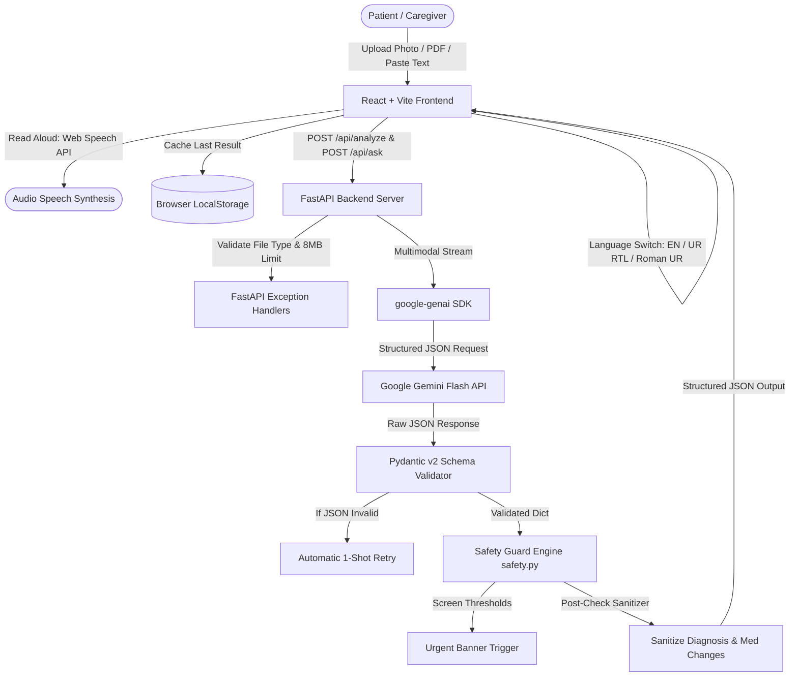

# SehatSamajh (صحت سمجھ)
### AI for Accessible Healthcare & Well-Being (UN SDG 3)
> **One-Line Pitch**: SehatSamajh translates complex medical reports and prescriptions into simple, empathetic Grade-6 explanations in Urdu, Roman Urdu, and English—with traffic-light indicators, doctor questions, and zero medical jargon.

[](https://fastapi.tiangolo.com)
[](https://react.dev)
[](https://tailwindcss.com)
[](https://ai.google.dev)
[](LICENSE)
[]()

---

## 1. Problem Statement
In Pakistan and across South Asia, millions of patients receive diagnostic lab reports and physician prescriptions that they cannot comprehend. These documents are overwhelmingly written in technical English medical jargon, abbreviated notations (e.g. TLC, ESR, HbA1c, PCV), and illegible clinical shorthand:
- **Severe Patient Confusion & Anxiety**: Patients cannot determine whether an out-of-range value is a mild deviation or an emergency.
- **Medication Mismanagement**: Non-English speakers struggle to follow dosage timings, leading to missed doses or premature cessation of antibiotics.
- **Passive Consultations**: Outpatient clinic visits are rushed, and patients don't know what questions to ask their doctor.
- **Language Exclusion**: Urdu and Roman Urdu readers lack accessible digital healthcare literacy tools.

**SehatSamajh** directly supports **UN Sustainable Development Goal 3 (Good Health and Well-Being)** by democratizing healthcare comprehension through safe, plain-language AI.

---

## 2. Target Users
1. **Everyday Patients & Families**: Non-English speakers, elderly family members, and caregivers who need clear, simple guidance about what a medical document means.
2. **Urdu and Roman Urdu Speakers**: Users who communicate in Urdu script or colloquial Roman Urdu and require healthcare insights in their primary language.
3. **Patients with Low Literacy**: Users who benefit from large typography, high-contrast traffic-light visual cues, and the Web Speech API read-aloud functionality.
4. **Primary Care Clinicians & Diagnostic Laboratories**: Labs, clinics, and pharmacies seeking to improve patient adherence, reduce medication errors, and improve doctor-patient dialogue.

---

## 3. Solution & Key Features
- **Multimodal Upload**: Accepts photos (PNG, JPG, WEBP), scanned PDFs, or pasted medical text up to 8 MB.
- **Trilingual Accessibility**: Instant one-click toggle between English, Roman Urdu, and Urdu (with native Right-to-Left layout and Google Fonts Noto Nastaliq Urdu typography).
- **Traffic-Light Results Table**: Green for normal, amber for low, red for high, and grey for unclear—evaluated **strictly** against the printed reference intervals.
- **Prescription Schedule Guide**: Extracts medicine name, dosage, frequency, general purpose, and important directions (e.g. complete 5-day course, take before breakfast).
- **Doctor Consultation Questions**: 3 to 5 practical, copyable questions the patient can ask their physician during their visit.
- **Calm Urgent Alerts**: Highlights critical physiological outliers with a calm, non-alarmist recommendation to consult a doctor soon.
- **Context-Bounded Follow-up Chat**: Interactive Q&A that answers strictly from the document and politely refuses diagnosis or treatment changes.
- **Audio Read-Aloud**: Browser-native Web Speech API reader that speaks the summary aloud (hides gracefully if voice is unsupported).
- **Privacy-First**: No database required; the last analysis is stored securely in browser `localStorage`.

---

## 4. AI Stack & How AI is Used
- **Multimodal Perception**: Accepts photos and PDFs directly into Google Gemini Flash (`gemini-2.5-flash` or `gemini-2.0-flash`) via the modern `google-genai` SDK using `types.Part.from_bytes`.
- **Grade-6 Reading Level Enforcement**: System prompts instruct the model to explain medical biomarkers at a 6th-grade reading level.
- **Printed Reference Range Anchoring**: The model evaluates biomarker status **only** by comparing to the reference range printed on the report. It never invents standard intervals.
- **Structured Pydantic v2 Validation**: The model is prompted with `response_mime_type="application/json"` and `response_schema=AnalysisResponse`. Output is validated with Pydantic v2.
- **Automated Self-Correction**: If the model response fails schema validation, the system automatically feeds the validation feedback into a single retry loop before reporting a friendly error.
- **Safety Post-Check Sanitization**: In `safety.py`, all generated summaries, biomarker explanations, and chat responses are filtered to rewrite or remove diagnostic proclamations (*"You have diabetes"*) or medicine change commands (*"Stop taking medication"*).

---

## 5. System Architecture



### Text-Based Architecture Flow:
1. **Frontend (Client)**: User uploads document image/PDF or pastes text, selects language (`en`, `ur`, `roman_ur`).
2. **API Endpoint (`/api/analyze`)**: FastAPI verifies file constraints (max 8 MB, PNG/JPG/WEBP/PDF).
3. **AI Service (`ai_service.py`)**: Assembles multimodal parts and system instructions. Calls Gemini Flash with structured schema.
4. **Validation & Retry**: Pydantic v2 parses the JSON. Retries once if validation fails.
5. **Safety Engine (`safety.py`)**: Enforces multilingual disclaimer, verifies critical physiological thresholds, and runs post-check regex sanitizers.
6. **Delivery**: Structured JSON is rendered in high-contrast traffic-light cards and cached to `localStorage`.

---

## 6. Safety Limits & What It Is NOT
**SehatSamajh is strictly an educational health literacy tool.**
- **NOT a Diagnostic Tool**: It does not diagnose medical diseases, infections, or syndromes.
- **NOT Clinically Validated**: It is an exploratory prototype designed for health communication, not a certified clinical decision support system.
- **NOT Medication Advice**: It never advises starting, pausing, altering, or stopping medications.
- **Mandatory Medical Disclaimer**: Every single response in all three languages concludes with a clear instruction: **Always confirm with your doctor**.
- **Unclear / Unrelated Documents**: If an image is blurred or unrelated to healthcare, the system returns status `unclear` and document type `unknown` rather than guessing.

---

## 7. Startup & Sustainability Model
> *Note: The business model below is an early hypothesis to be validated through structured pilot partnerships with local diagnostic centers.*

### B2B Add-On Model (Primary Revenue)
- **Diagnostic Laboratories (Chughtai Lab, Excel Labs, Shaukat Khanum, Essa, Al-Khidmat)**: Pathology labs in Pakistan deliver millions of PDF reports via SMS/WhatsApp links every month. SehatSamajh can be offered as a white-labeled value-added service (an "Aasan Urdu Summary" link alongside the raw PDF) billed on a monthly tier or micro-fee per report.
- **Retail Pharmacy Chains (D.Watson, Fazal Din, Servaid)**: Pharmacies license our plain-language prescription schedule generator at points of sale to print or SMS clear instructions to patients, reducing dosage errors.

### Patient Freemium Tier
- **Free Patient Tier**: Patients can always paste text and upload documents for free on the public web app.
- **Future Premium Tier**: Family health vault, longitudinal biomarker trend tracking (e.g. HbA1c over 12 months), and WhatsApp bot access.

---

## 8. Setup & Installation Steps

### Prerequisites
- Python 3.11+
- Node.js 18+ and npm
- A Google Gemini API Key ([Get one free at Google AI Studio](https://aistudio.google.com/))

### Step 1: Clone Repository
```bash
git clone https://github.com/FAISALREHMAN-AI/sehatsamajh-ai.git
cd sehatsamajh-ai
```

### Step 2: Backend Setup
```bash
cd backend
python -m venv venv
# On Windows:
.\venv\Scripts\activate
# On Linux/macOS:
source venv/bin/activate

pip install -r requirements.txt
cp .env.example .env
```
Edit `.env` and set your Gemini API key:
```env
GEMINI_API_KEY=your_actual_gemini_api_key_here
GEMINI_MODEL=gemini-2.5-flash
HOST=0.0.0.0
PORT=8000
```
Run backend tests to verify:
```bash
python -m pytest -v
```
Start the backend server:
```bash
uvicorn main:app --reload --port 8000
```
Backend will be live at `http://localhost:8000` (Health check: `http://localhost:8000/api/health`).

### Step 3: Frontend Setup
Open a new terminal:
```bash
cd frontend
npm install
npm run dev
```
Frontend will be live at `http://localhost:5173`.

---

## 9. Environment Variables
| Variable | Description | Default | Location |
| :--- | :--- | :--- | :--- |
| `GEMINI_API_KEY` | Google Gemini API key from AI Studio | *Required* | Backend `.env` |
| `GEMINI_MODEL` | Gemini model name | `gemini-2.5-flash` | Backend `.env` |
| `HOST` | Backend server host | `0.0.0.0` | Backend `.env` |
| `PORT` | Backend server port | `8000` | Backend `.env` |
| `VITE_API_URL` | Base URL of the FastAPI backend | `http://localhost:8000` | Frontend `.env` (optional) |

---

## 10. How to Run the Demo
1. Open `http://localhost:5173` in your browser.
2. Click **"Try Sample Lab Report"** or **"Try Sample Prescription"** on the home screen to automatically run the live AI analysis on the synthetic sample (or click "Upload Medical Document" to upload your own).
3. Observe the **Urgent Banner** triggered by the critically low hemoglobin (6.2 g/dL), the **traffic-light table**, **3-5 doctor questions**, and the **audio Read-Aloud** button.
4. Click **"Analyze Another"**, toggle the language to **اردو**, load the **Sample Prescription (3 medicines)**, and observe the full RTL Urdu experience.
5. In the **Chat Box**, ask a question (e.g. *"Can I stop taking Augmentin once my fever goes down?"*) and observe the safe non-prescriptive response.

For complete click-by-click instructions, refer to [docs/DEMO_SCRIPT.md](docs/DEMO_SCRIPT.md).  
For the 6-minute presentation script, refer to [docs/PITCH.md](docs/PITCH.md).  
For the detailed technical report, refer to [docs/REPORT.md](docs/REPORT.md).

---

## 11. Assumptions
1. **Document Legibility**: The model assumes printed or reasonably legible handwritten text. If handwriting is unreadable, it explicitly assigns `status: "unclear"`.
2. **Reference Ranges**: We assume diagnostic documents include printed reference intervals. If absent, the AI will not guess ranges.
3. **No Central Database**: To maximize user privacy and minimize compliance exposure, patient data is kept strictly client-side in `localStorage`.
4. **Language Fallback**: If a user's browser lacks an Urdu text-to-speech voice pack, the Web Speech Read-Aloud button gracefully hides without breaking the UI.

---

## 12. Future Work & Roadmap
1. **Zero-Retention Encrypted Pipeline**: Automated on-device PII masking (blurring patient names and phone numbers prior to LLM transmission).
2. **Clinical Validation Pilots**: Formal trials with teaching hospitals in Pakistan to evaluate health comprehension scores in outpatient waiting rooms.
3. **Additional Regional Languages**: Integration of Punjabi (Shahmukhi/Gurmukhi), Sindhi, Pashto, and Balochi.
4. **WhatsApp Bot Integration**: Enabling rural users to photograph reports and receive voice note explanations over low-bandwidth WhatsApp.
